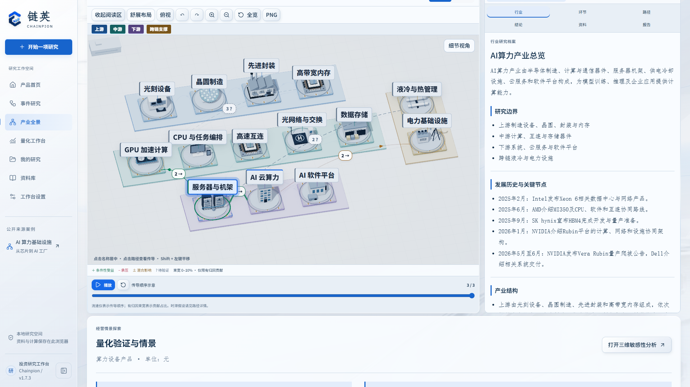
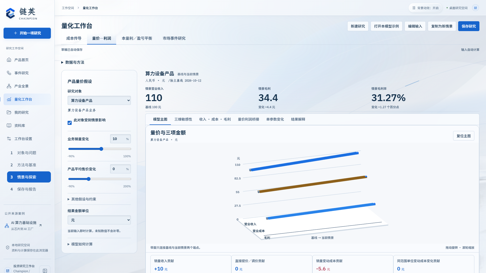

# 链英 Chainpion

### 产业链影响分析与交互式量化研究工具

链英面向一级市场研究员、投资经理与产业研究团队，围绕原材料价格、供需变化、政策调整和重大事件，连接**产业结构阅读、事件传导分析、经营情景测算与研究依据交付**。

用户从一个事件开始，定位上下游与跨产业链环节，查看代表企业和成立条件，再用明确的业务基线与参数，分析收入、成本、毛利及经营门槛如何变化。



## 核心能力

| 研究任务 | 产品能力 | 研究结果 |
| --- | --- | --- |
| 快速理解一个行业 | 三维产业全景、上下游拆解、节点档案、代表企业与来源链接 | 产业结构与关键业务环节 |
| 分析事件影响 | 传导路径、成立条件、跨链约束与贡献解释 | 变化作用于谁、通过什么机制生效 |
| 验证经营判断 | 成本传导、量价—利润、本量利、市场事件研究四类方法 | 可调整、可复算的数值结果 |
| 找出判断改变的条件 | 单参数敏感性、双参数空间、对象与版本比较 | 关键参数、正负边界与情景差异 |
| 核对研究依据 | 字段来源、资料候选审核、引用定位、假设记录 | 事实、输入假设与模型推导的对应关系 |
| 形成团队交付 | 保存研究版本；量化模块导出 Word、Markdown、HTML | 带输入、方法、来源和图表的成果 |

## 当前仓库组成

- **`frontend/`：Chainpion v1.7.3 的可运行网页交付文件**，包括界面、三维展示与演示案例。
- **`quant-module/`：独立量化模块 v0.4.2 的完整前后端源码**，包括 Node.js 服务、四类计算方法、资料处理、图表和测试。
- **`examples/`：从同版研究中提取的两份经营情景输入与预期结果**。
- **`docs/`：使用流程、模型公式、系统结构、接口对接说明与实机图**。

网页演示与独立量化模块分别启动。v1.7.3 目录保存的是前端构建成品；主模块的完整开发工程及主 Agent 服务端在团队后续集成时接入。当前网页演示的模型、搜索与行情服务连接状态记录为未接通。

## 快速开始

### 1. 获取项目

```bash
git clone https://github.com/RhettWei/Chainpion-Industry-Chain-Analysis-Tool.git
cd Chainpion-Industry-Chain-Analysis-Tool
```

### 2. 启动最新版网页演示

在仓库根目录运行 Python 3 的静态文件服务：

```bash
python -m http.server 5188 --bind 127.0.0.1 --directory frontend
```

打开 **http://127.0.0.1:5188/**。浏览器需支持 WebGL2；从首页进入研究工作台，可查看产业全景、算力与锂电案例、量化展示、资料与成果。

### 3. 启动可独立使用的量化模块

需要 **Node.js 20 或以上**。核心功能使用 Node.js 标准库，无需安装 npm 依赖：

```bash
npm start
```

打开 **http://127.0.0.1:4318/**。也可进入 `quant-module`，执行 `node server.mjs`，或在 Windows 双击该目录下的 `启动量化模块.cmd`。

### 4. 运行测试

```bash
npm test
```

测试覆盖经营计算、逐对象情景、来源审核、事件研究、资料解析、接口、导出与展示数据。

## 四类量化模型

| 模型 | 适合回答的问题 | 主要输出 |
| --- | --- | --- |
| 成本传导 | 指定材料或能源单价改变后，节约或压力如何在成本、售价与利润之间分配？ | 成本贡献、毛利变化、转嫁／让利与时滞情景 |
| 量价—利润 | 该产品的平均售价、销量和单位变动成本同时变化，经营结果如何改变？ | 收入、营业成本、毛利、贡献桥接 |
| 本量利／盈亏平衡 | 需要达到什么收入或销量水平，才能覆盖固定成本与经营费用？ | 盈亏平衡门槛、贡献毛益、安全边际 |
| 市场事件研究 | 事件窗口内，证券相对市场基准的反应如何？ | AR、CAR、累计收益、成交量Z与最大回撤 |

公式、参数与单位见 [模型与计算口径](docs/models.md)。成本、销量、产品售价及受影响对象分别设置；同属某个产业环节的企业可以具有不同的冲击参数。



## 演示案例：需求增长如何影响利润

同一规范化算力设备产品业务，基线收入100元、营业成本70元、毛利30元，变动成本占营业成本80%。

| 情景 | 产品销量变化 | 产品平均售价变化 | 收入（元） | 成本（元） | 毛利（元） |
| --- | ---: | ---: | ---: | ---: | ---: |
| A | +10% | 0% | 110 | 75.6 | 34.4 |
| B | +5% | 0% | 105 | 72.8 | 32.2 |
| C | +10% | -5% | 104.5 | 75.6 | 28.9 |

情景A的毛利增长14.67%；情景C说明销量提升可能被售价下降抵消。**行业需求增长与具体产品销量变化分别确认**，便于继续核对订单、交付、配置与供应约束。

电芯对照案例采用相同100元收入、70元成本基线，其中指定材料成本14元。该材料单价下降10%、售价和销量不变时，成本降至68.6元，毛利升至31.4元。

案例中的经营基线与冲击为明确标记的情景假设。输入 JSON 的引擎金额单位为万元，`0.01万元=100元`；观察窗口与基线期间分别保存，不自动按窗口长度缩放金额。

## 数据与配置

基础经营测算和内置案例无需模型 Key。外部数据按实际用途配置：

| 配置 | 用途 |
| --- | --- |
| `TUSHARE_TOKEN` | 行情、复权及可访问财务字段的候选查询 |
| `BRAVE_SEARCH_API_KEY` | 网页搜索候选来源 |
| `PDFJS_MODULE` | 可选，本地可检索PDF的文字解析模块 |
| `PORT` | 量化服务端口，默认4318 |

模板见 [`quant-module/.env.example`](quant-module/.env.example)。Node.js 20.6+ 可在量化目录复制模板为 `.env` 后使用 `node --env-file=.env server.mjs`；也可通过终端或部署平台设置环境变量，再运行 `npm start`。普通 `npm start` 读取进程环境变量。

资料候选保留来源、摘录、单位、期间和审核状态，用户确认后才进入基线。真实 Key、私人资料和运行日志均不进入本仓库。

## 进一步阅读

- [完整使用流程](docs/workflow.md)
- [四模型公式与数值口径](docs/models.md)
- [模块结构与后端对接](docs/architecture.md)
- [量化模块详细启动与对接说明](quant-module/启动与对接说明.md)
- [两份同版情景输入](examples/README.md)
- [第三方组件许可](THIRD-PARTY-NOTICES.txt)

本仓库不包含宣传视频、视频制作工程、FFmpeg工具、私人凭据或临时渲染文件。项目代码的开源授权由维护团队确认，第三方组件继续遵循各自许可。
